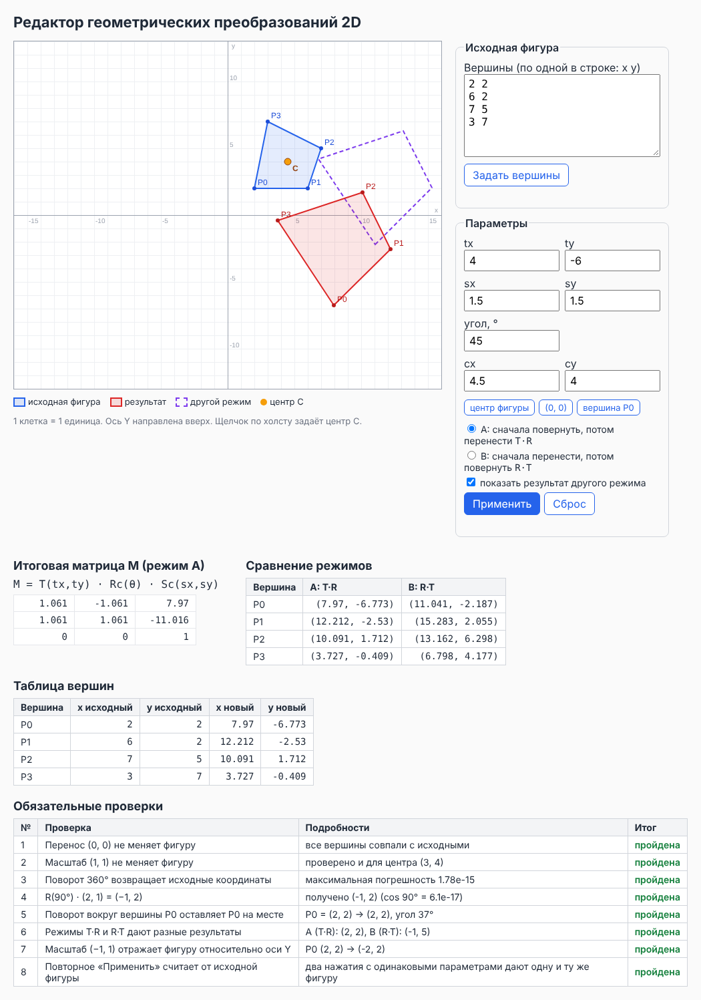

# ЛР7. Редактор геометрических преобразований 2D

## Запуск

Открыть `index.html` в браузере. Библиотеки не нужны.

## Матрицы (однородные координаты, векторы-столбцы)

Точка `(x, y)` записывается как столбец `(x, y, 1)ᵀ`.

```text
T(tx,ty) = | 1  0  tx |     S(sx,sy) = | sx  0  0 |     R(θ) = | cosθ  −sinθ  0 |
           | 0  1  ty |                |  0 sy  0 |            | sinθ   cosθ  0 |
           | 0  0   1 |                |  0  0  1 |            |   0      0   1 |
```

Применение к точке (`transformPoint`):

```text
x' = m00·x + m01·y + m02
y' = m10·x + m11·y + m12
```

## Умножение матриц

`multiplyMatrices(a, b)` — три вложенных цикла:

```text
C[i][j] = A[i][0]·B[0][j] + A[i][1]·B[1][j] + A[i][2]·B[2][j]
```

Функция `compose(M1, M2, …, Mn)` перемножает матрицы слева направо. В записи `P' = M1 · M2 · … · Mn · P` **к точке первой применяется самая правая матрица**.

## Центр преобразования

Обычные S и R работают относительно (0, 0). Для центра C(cx, cy):

```text
Sc = T(cx,cy) · S(sx,sy) · T(−cx,−cy)   — масштаб вокруг C
Rc = T(cx,cy) · R(θ)     · T(−cx,−cy)   — поворот вокруг C
```

По умолчанию центр — (0, 0); кнопкой «центр фигуры» он ставится в среднее арифметическое вершин, для исходной фигуры это `(4.5, 4)`.

Итоговая матрица:

```text
Режим A (сначала повернуть, потом перенести): M = T(tx,ty) · Rc · Sc
Режим B (сначала перенести, потом повернуть): M = Rc · T(tx,ty) · Sc
```

## Ручной расчёт: поворот на 90° вокруг C(4, 4)

```text
T(−4,−4): сдвигаем C в начало координат
R(90°):   cos 90° = 0, sin 90° = 1
T(4,4):   возвращаем обратно

R · T(−4,−4) = | 0 −1  0 |   | 1 0 −4 |   | 0 −1   4 |
               | 1  0  0 | · | 0 1 −4 | = | 1  0  −4 |
               | 0  0  1 |   | 0 0  1 |   | 0  0   1 |

M = T(4,4) · (R · T(−4,−4)) = | 0 −1  8 |
                              | 1  0  0 |
                              | 0  0  1 |
```

Подробно для P1 = (6, 2):

```text
1) сдвиг:   (6 − 4, 2 − 4) = (2, −2)
2) поворот: x' = 2·0 − (−2)·1 = 2,  y' = 2·1 + (−2)·0 = 2  → (2, 2)
3) возврат: (2 + 4, 2 + 4) = (6, 6)
Через M:    x' = 0·6 − 1·2 + 8 = 6,  y' = 1·6 + 0·2 + 0 = 6  → (6, 6) ✓
```

| Вершина | x исходный | y исходный | x' = −y + 8 | y' = x |
|---|---:|---:|---:|---:|
| P0 | 2 | 2 | 6 | 2 |
| P1 | 6 | 2 | 6 | 6 |
| P2 | 7 | 5 | 3 | 7 |
| P3 | 3 | 7 | 1 | 3 |

Программа выдаёт те же числа (параметры: угол 90, cx = 4, cy = 4, остальное по умолчанию).

## Два порядка преобразований

Пример из раздела 9: точка P = (2, 1), поворот 90° вокруг (0, 0), перенос (3, 0).

```text
A: M = T(3,0) · R(90°) = | 0 −1  3 |      B: M = R(90°) · T(3,0) = | 0 −1  0 |
                         | 1  0  0 |                               | 1  0  3 |
                         | 0  0  1 |                               | 0  0  1 |

A: (2, 1) → поворот → (−1, 2) → перенос → (2, 2)
B: (2, 1) → перенос → (5, 1) → поворот → (−1, 5)
```

Результаты разные: **(2, 2)** и **(−1, 5)**.

Почему отличаются: умножение матриц некоммутативно, `T·R ≠ R·T`. Поворот вращает всё вокруг центра, в том числе вектор переноса. В режиме A перенос делается уже после поворота, поэтому фигура сдвигается ровно на (3, 0). В режиме B сначала сдвигаем, а потом поворот на 90° «разворачивает» и этот сдвиг: вектор (3, 0) превращается в (0, 3). Это видно и по матрицам: в A третий столбец `(3, 0)`, в B — `(0, 3)`.

На холсте при включённом флажке «показать результат другого режима» оба варианта видны одновременно, а таблица «Сравнение режимов» показывает координаты каждой вершины для A и B.

## Результаты обязательных проверок

Проверки запускаются автоматически при открытии страницы (таблица внизу).

| № | Проверка | Результат |
|---|---|---|
| 1 | Перенос (0, 0) не меняет фигуру | пройдена |
| 2 | Масштаб (1, 1) не меняет фигуру (и при центре (3, 4)) | пройдена |
| 3 | Поворот 360° возвращает исходные координаты | пройдена, погрешность ≈ 1.8·10⁻¹⁵ |
| 4 | R(90°) · (2, 1) = (−1, 2) | пройдена; cos 90° в JS = 6.1·10⁻¹⁷, поэтому сравнение с допуском |
| 5 | Поворот на 37° вокруг вершины P0 оставляет P0 = (2, 2) на месте | пройдена |
| 6 | Режимы T·R и R·T дают (2, 2) и (−1, 5) | пройдена |
| 7 | Масштаб (−1, 1) отражает фигуру: P0 (2, 2) → (−2, 2) | пройдена |
| 8 | Повторное «Применить» пересчитывает от исходных вершин | пройдена: два нажатия дают одну и ту же фигуру |

## Скриншот

Пример: перенос (4, −6), масштаб 1.5, поворот 45° вокруг центра фигуры (4.5, 4), режим A.


