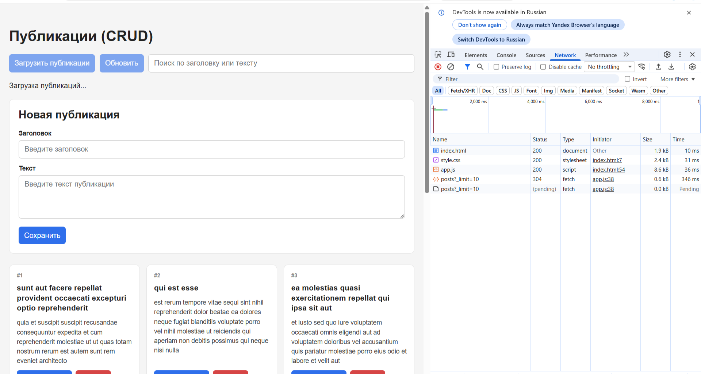
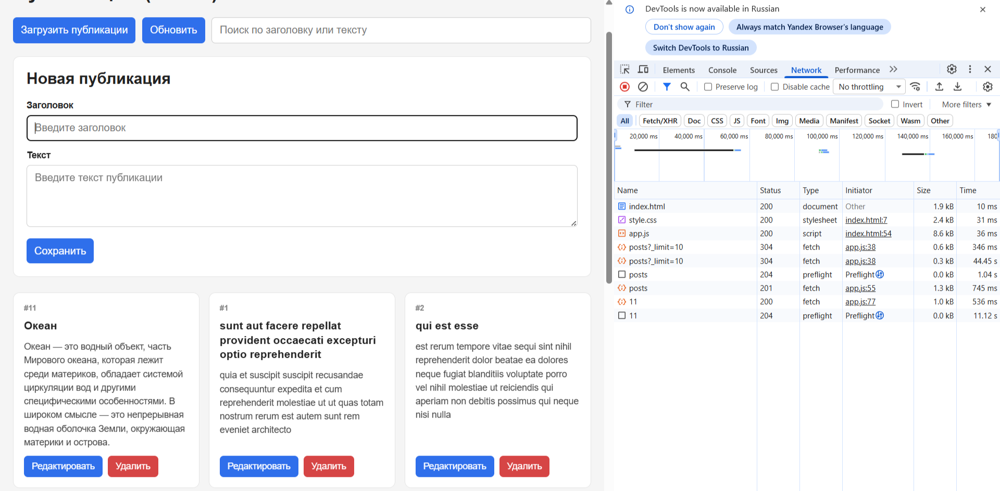
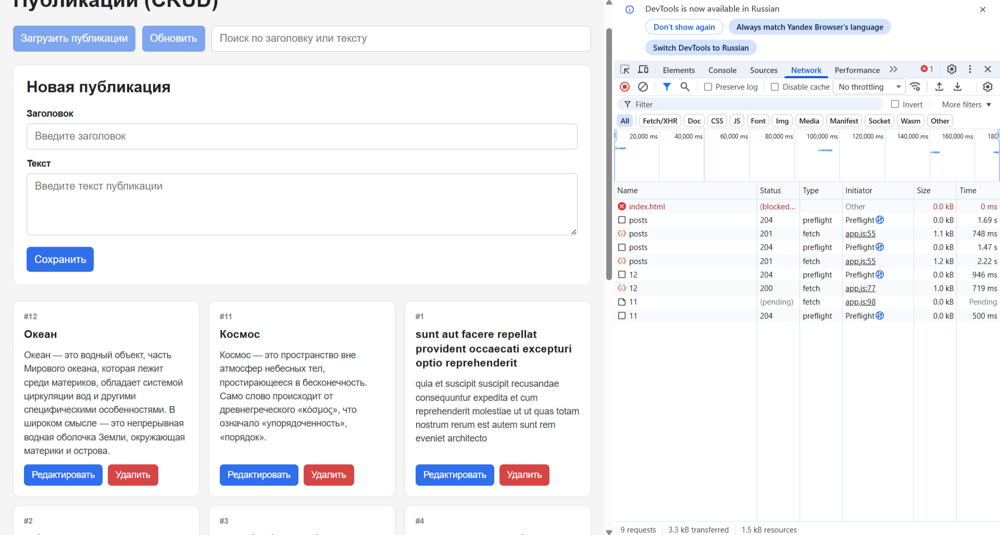
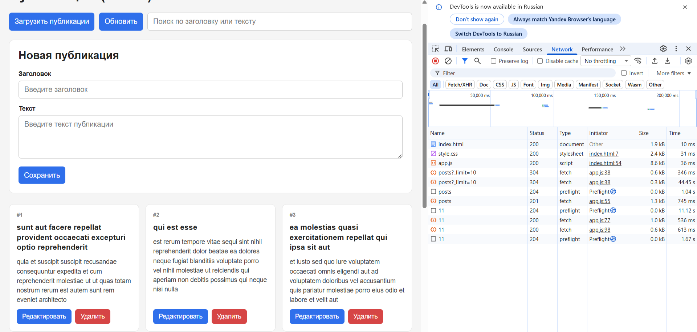

## 1. Как запустить проект

1. Открыть папку `04/` в проводнике.
2. Открыть файл `index.html` в браузере (двойной клик) **или** запустить через Live Server в VS Code.
3. При открытии страницы автоматически выполняется `GET`-запрос и загружаются 10 публикаций.
4. Для проверки запросов открыть DevTools → вкладка **Network**.


## 2. Какой API используется

Используется публичный тестовый REST API:
https://jsonplaceholder.typicode.com/posts


## 3. Какие HTTP-методы реализованы

Реализованы все четыре метода CRUD:

`GET` загрузка списка публикаций (`?_limit=10`) `loadPosts()` 

`POST` создание новой публикации `createPost()`

`PATCH` частичное обновление публикации по `:id`  `updatePost()` 

`DELETE`  удаление публикации по `:id`  `deletePost()` 

## 4. Как устроено состояние приложения

Всё состояние хранится в одном объекте `state`:

```js
const state = {
  posts: [],          // массив загруженных публикаций
  filter: '',         // строка поиска
  isLoading: false,   // идёт ли загрузка (GET)
  isSaving: false,    // идёт ли сохранение (POST/PATCH)
  isDeleting: false,  // идёт ли удаление (DELETE)
  error: null,        // текст последней ошибки
  editingId: null     // id редактируемой записи (null = режим создания)
};
```
Принцип работы:

text
действие пользователя
        ↓
HTTP-метод (fetch)
        ↓
ответ сервера
        ↓
изменение state
        ↓
render()
Сначала выполняется запрос, и только после успешного ответа обновляется state.posts, а затем вызывается render().

## 5. Как обрабатываются ошибки
Все сетевые операции обёрнуты в try / catch.

После каждого fetch проверяется response.ok. Если false — генерируется исключение с кодом ответа.

Текст ошибки сохраняется в state.error и отображается в блоке #status красным цветом.

Ошибки формы (пустые поля) показываются отдельно в #formError под формой.

Флаги isSaving и isDeleting блокируют кнопки, поэтому быстрыми повторными нажатиями нельзя создать несколько одинаковых запросов.

Если запрос упал — state.posts не меняется, интерфейс остаётся в прежнем состоянии.

## 6. Что происходит после успешного POST, PATCH и DELETE
Метод	Действие после успешного ответа
POST	объект из response.json() добавляется в начало state.posts через unshift() → render()
PATCH	в state.posts находится запись с нужным id и заменяется объединённым объектом { ...old, ...updated } → render()
DELETE	из state.posts удаляется запись с указанным id через filter() → render()
Во всех трёх случаях порядок один: успешный ответ → изменение state → render().

## 7. Почему изменения исчезают после полной перезагрузки страницы
Потому что jsonplaceholder.typicode.com — это статический мок-сервер:

POST, PATCH и DELETE возвращают «успешный» ответ, но реально ничего не сохраняют на сервере.

Все изменения живут только в памяти браузера — в объекте state.posts.

При нажатии F5 JavaScript перезапускается, state.posts = [], и снова вызывается loadPosts(), который делает GET ?_limit=10 и получает исходные первые 10 публикаций.

То есть после перезагрузки мы видим не «потерянные» данные, а исходное состояние учебного API.


### Скриншоты Network
**GET:**


**POST:**


**PATCH:**


**DELETE:**

